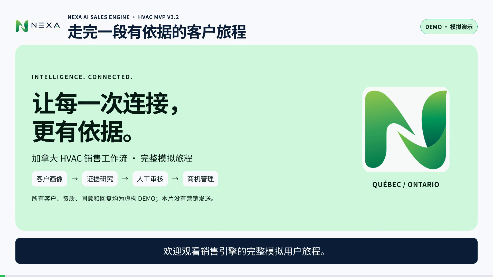

# NEXA HVAC V3.2 · 完整模拟用户旅程视频

4 分 51 秒，1920×1080，24fps，中文旁白与烧录中文字幕。

实际 DEMO 工作台的 18 步完整流程：客户画像 → 来源路由 → 两省模拟研究 → 证据与资质审核 → ICP 评分 → 联系依据人审 → 草稿与版本审批 → 回复分类 → CRM 商机/待办 → 退订阻断 → 操作审计。

所有企业、联系人、资质、同意及回复均为明确标记的虚构 DEMO；未调用真实获客供应商，未发送营销消息。当前影片不代替真实渠道接入、生产部署或独立企业试点验收。

## 下载

- [完整介绍视频 MP4（约 21 MB）](https://github.com/ryanshang2024/codex-cloud-nexa/raw/refs/heads/media/nexa-hvac-user-journey-v3-2/NEXA_HVAC_User_Journey_V3_2.mp4)
- [中文字幕 SRT](https://github.com/ryanshang2024/codex-cloud-nexa/raw/refs/heads/media/nexa-hvac-user-journey-v3-2/NEXA_HVAC_User_Journey_V3_2.zh.srt)
- [可编辑源文件 ZIP（约 32 MB）](https://github.com/ryanshang2024/codex-cloud-nexa/raw/refs/heads/media/nexa-hvac-user-journey-v3-2/NEXA_HVAC_User_Journey_V3_2_Source.zip)

若浏览器直接播放 MP4，可在播放器菜单选择「下载」，或右键链接选择「链接另存为」。文件页面右上角的「Download raw file」也可下载。

## 验证

最终 MP4 完整解码无错误，26 处实片画面已核对，19 个章节导航，38 段字幕。技术信息与散列见 `VALIDATION.json`、`SHA256SUMS.txt`。

源包包含 HTML/GSAP 合成、录屏片段、品牌字体、配音与原创音乐；不含凭据、数据库、原始上传文档、语音模型权重或依赖目录。

## 中文销售宣传单

完整图解：画像设定 → 授权企业来源 → 数据与资质核验 → AI 草稿和人工审批 → 授权自动触达（后续规划）→ 回复和 CRM 闭环。

- [PNG 图片](flyer/NEXA_AI_Sales_Engine_Flyer_CN.png)
- [A4 打印 PDF](flyer/NEXA_AI_Sales_Engine_Flyer_CN_A4.pdf)

当前是 MVP 能力蓝图；真实渠道与 AI 服务待接入，自动发送未启用。

## 加盟商商业宣传片（约 46 秒）

中文配音、中文字幕、1080p，介绍从客户画像到 CRM 的销售流程。

- [下载宣传片 MP4](commercial/NEXA_Franchise_Commercial_V3_2_CN_46s.mp4?raw=true)
- [宣传片说明](commercial/README.zh.md)
- [可编辑工程](commercial/NEXA_Franchise_Commercial_Source.zip?raw=true)

